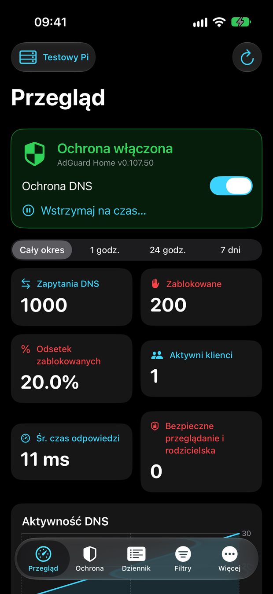
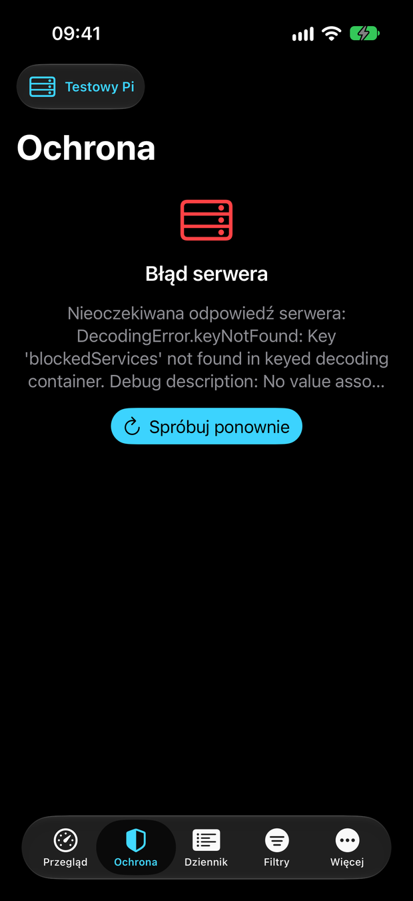
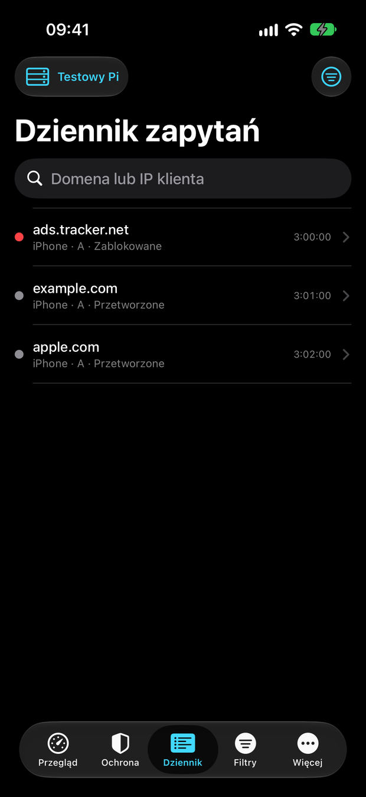
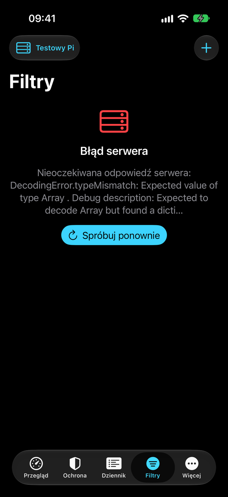
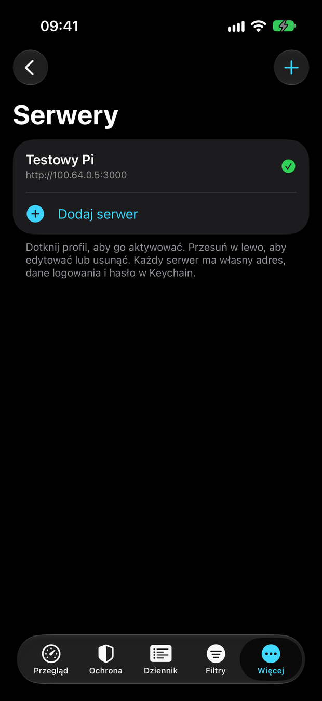
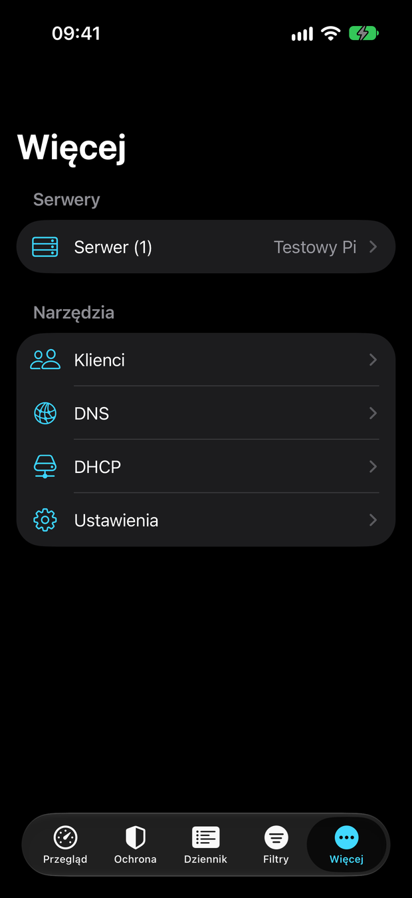
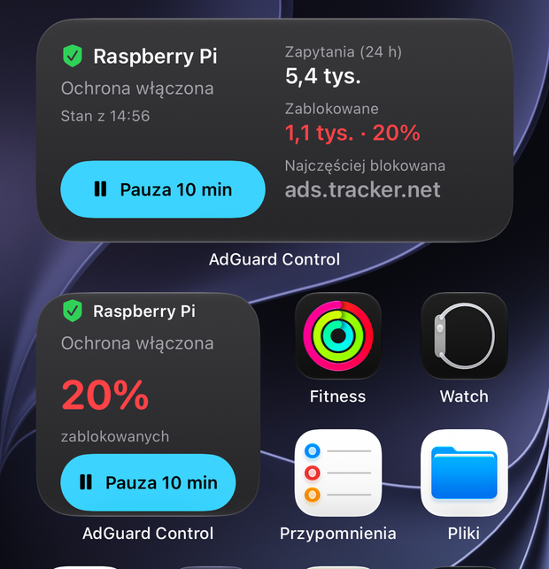

# AdGuard Control

[English](README.md) · **Polski**

Natywna aplikacja iOS (Swift / SwiftUI, iOS 17+) do zarządzania własnym serwerem [AdGuard Home](https://github.com/AdguardTeam/AdGuardHome) z iPhone'a. Przeznaczona głównie dla Raspberry Pi dostępnego przez [Tailscale](https://tailscale.com) lub sieć domową.

Klient API powstał na podstawie oficjalnej specyfikacji OpenAPI AdGuard Home (API v0.107). Żaden endpoint nie jest wymyślony, przestarzałe endpointy nie są używane, a projekt nie ma **żadnych zależności zewnętrznych** (tylko SwiftUI, Swift Charts, Security.framework i URLSession).

> **Projekt nieoficjalny.** AdGuard Control to niezależna aplikacja. Nie jest powiązana z AdGuard Software Ltd., przez nią popierana ani sponsorowana. „AdGuard” i „AdGuard Home” są znakami towarowymi ich właścicieli.

> **Uwaga o języku:** interfejs aplikacji jest obecnie **wyłącznie po polsku**. Dokumentacja jest domyślnie po angielsku ([README.md](README.md)), a ta wersja jest jej polskim odpowiednikiem.

<p align="center">
  
  
  
  
</p>

## Funkcje

- **Przegląd**: stan ochrony, liczniki (zapytania, zablokowane, % blokowania, klienci, czas odpowiedzi), wykres aktywności, top domeny / zablokowane / klienci, pauza ochrony na 1 min / 10 min / 1 h / 24 h.
- **Ochrona**: ochrona DNS, filtrowanie, bezpieczne przeglądanie, kontrola rodzicielska (włącz/wyłącz), bezpieczne wyszukiwanie osobno dla każdej wyszukiwarki, blokowane usługi, sprawdzanie domeny.
- **Dziennik zapytań**: doczytywanie, wyszukiwanie z opóźnieniem (debounce), filtry statusu i klienta, szczegóły oraz szybkie akcje (blokuj / zezwól / własna reguła), także gestem przesunięcia.
- **Filtry**: listy blokujące i zezwalające (dodawanie, edycja, usuwanie, włączanie, odświeżanie, interwał aktualizacji), własne reguły, DNS rewrites.
- **Klienci, DNS, DHCP, TLS, kontrola dostępu, ustawienia ogólne** (retencja statystyk i query logu, czyszczenie statystyk/logu/cache, aktualizacje serwera).
- **Wiele serwerów** z szybkim przełącznikiem; każdy profil ma własny adres, login, opcję „Wymagaj Tailscale” i hasło w Keychain.
- **Widgety** (ekran główny i ekran blokady) z przyciskiem pauzy. Zob. [docs/pl/widgets.md](docs/pl/widgets.md).
- **Diagnostyka**: gdy połączenie zawiedzie, aplikacja pokazuje listę kontrolną (czy Tailscale działa, czy serwer jest online, czy port jest poprawny).
- Każda zmiana konfiguracji wymaga potwierdzenia i, gdy to możliwe, ma przycisk **Cofnij**.

<p align="center">
  
  
  
</p>

## Wymagania

- Xcode 16 lub nowszy (projekt rozwijany w Xcode 27) i iOS 17+.
- Serwer AdGuard Home (API v0.107) dostępny z iPhone'a, najlepiej przez Tailscale. Zob. [docs/pl/tailscale.md](docs/pl/tailscale.md).
- [XcodeGen](https://github.com/yonaskolb/XcodeGen) do wygenerowania projektu Xcode: `brew install xcodegen`.

## Budowanie i uruchomienie

```bash
git clone https://github.com/nullDEM/adguard-control.git
cd adguard-control
xcodegen generate
open AdGuardControl.xcodeproj
```

Wybierz scheme **AdGuardControl** i symulator, potem ⌘R. Testy: ⌘U albo:

```bash
xcodebuild -project AdGuardControl.xcodeproj -scheme AdGuardControl \
  -destination 'platform=iOS Simulator,name=iPhone 17' test
```

Do uruchomienia na prawdziwym iPhonie potrzebujesz własnej konfiguracji podpisywania (Team, bundle identifier, App Group i Keychain Sharing). Zob. [docs/pl/development.md](docs/pl/development.md).

## Pierwsza konfiguracja w aplikacji

1. Przy pierwszym uruchomieniu pojawi się ekran **Nowy serwer**.
2. Wpisz nazwę profilu, np. „Raspberry Pi”.
3. Wpisz adres, np. `http://100.x.y.z:3000` (adres Tailscale) albo nazwę MagicDNS. Schemat można pominąć (aplikacja doda `http://`), końcowy `/` i `/control` są usuwane. Port musi być taki, jak w interfejsie webowym Twojego AdGuard Home. Zob. [przewodnik po portach](docs/pl/tailscale.md#port-interfejsu-webowego-80-3000-czy-inny).
4. Podaj login i hasło AdGuard Home.
5. Opcjonalnie włącz **Wymagaj Tailscale**: aplikacja nie wyśle żadnego zapytania, dopóki iPhone nie ma aktywnego interfejsu Tailscale.
6. Naciśnij **Testuj połączenie**, a potem **Zapisz**.

## Bezpieczeństwo w skrócie

- Hasła są przechowywane **wyłącznie w Keychain iOS**. Profile w `UserDefaults` nie zawierają sekretów. Aplikacja nigdy nie loguje haseł ani nagłówków `Authorization`.
- HTTP bez szyfrowania jest dozwolone tylko w sieciach prywatnych, Tailscale i na loopbacku. Hosty publiczne wymagają HTTPS, adresy specjalne (link-local, multicast, `0.0.0.0`) są odrzucane, a przekierowania HTTP nie są śledzone.
- Weryfikacja TLS nigdy nie jest wyłączana.

Szczegóły i uzasadnienie ustawienia App Transport Security: [docs/pl/security.md](docs/pl/security.md).

## Dokumentacja

| Temat | English | Polski |
|---|---|---|
| Tailscale, porty, konfiguracja Raspberry Pi | [docs/tailscale.md](docs/tailscale.md) | [docs/pl/tailscale.md](docs/pl/tailscale.md) |
| Widgety | [docs/widgets.md](docs/widgets.md) | [docs/pl/widgets.md](docs/pl/widgets.md) |
| Bezpieczeństwo | [docs/security.md](docs/security.md) | [docs/pl/security.md](docs/pl/security.md) |
| Rozwój, testy, podpisywanie | [docs/development.md](docs/development.md) | [docs/pl/development.md](docs/pl/development.md) |
| Pokrycie API i ograniczenia | [docs/api-coverage.md](docs/api-coverage.md) | [docs/pl/api-coverage.md](docs/pl/api-coverage.md) |

## Struktura projektu

```
project.yml                   definicja projektu XcodeGen (źródło prawdy)
AdGuardControl/               aplikacja
  App/                        punkt wejścia, RootView, pasek zakładek, atrapa serwera do testów UI (tylko Debug)
  Models/                     modele Codable zgodne z OpenAPI
  Networking/                 AdGuardAPIClient (async/await, URLSession), APIError
  Storage/                    KeychainStore (hasła), ProfileStore, współdzielony magazyn App Group
  Utilities/                  normalizacja URL, polityka adresów, wykrywanie Tailscale, walidatory
  ViewModels/                 MVVM: AppState i po jednym VM na sekcję
  Views/                      ekrany SwiftUI
  Widget/                     kod współdzielony z rozszerzeniem widgetu (migawka, deep linki)
AdGuardWidgets/               rozszerzenie WidgetKit (widgety ekranu głównego i blokady)
AdGuardControlTests/          testy jednostkowe
AdGuardControlUITests/        testy UI (XCUITest)
branding/final/               logo (SVG) i ikona aplikacji 1024 px
docs/                         dokumentacja (angielska) i docs/pl (polska)
```

## Testy

Testy jednostkowe używają `URLProtocol`, więc nie potrzebują sieci ani serwera. Testy UI uruchamiają aplikację z argumentem `-uitest`, który podmienia warstwę sieciową na wbudowany serwer testowy (kompilowany tylko w buildach Debug). Szczegóły: [docs/pl/development.md](docs/pl/development.md).

## Licencja

[MIT](LICENSE)
